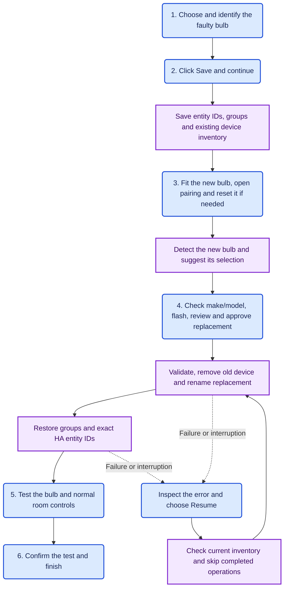

# Zigbee2MQTT Device Swap

Replace a failed Zigbee bulb from Home Assistant. The integration saves the old bulb's exact HA entity IDs and Zigbee2MQTT groups, guides pairing, then applies the replacement after you review it.

Status: **early development, validated with physical Philips Hue GU10 replacements** on Home Assistant 2026.10.4 and Zigbee2MQTT 2.14.2. Individual bulb controls and restored group controls have been confirmed working. Other devices and versions still need testing.

## Requirements

- Home Assistant 2026.10 or later (uses its current `probatio` schemas).
- Zigbee2MQTT 2.x with Home Assistant discovery enabled.
- HA's MQTT integration configured and connected to the same broker.
- An administrator account for the replacement interface.
- Single-channel light bulbs; old and replacement must expose matching entity features and group endpoints. Philips Hue bulbs with endpoint 11 plus Green Power endpoint 242 are supported by the endpoint checks.

No cloud service or separate API key is used. The installed integration reuses HA's MQTT connection; its card uses your existing HA session. A token is needed only for optional development/installation scripts.

## Install

### Install through HACS

[HACS](https://www.hacs.xyz/docs/use/) must already be installed in Home Assistant. This integration is available as a **custom repository**.

1. Open **HACS**, select the three-dot menu, then **Custom repositories**.
2. Enter `https://github.com/simonjgreen/z2m-device-swap` and select **Integration** as the repository type, then **Add**.
3. Find **Zigbee2MQTT Device Swap** in HACS, open it, and select **Download**. If no tagged release is offered, select the default `main` branch.
4. Restart Home Assistant to load the integration.
5. Go to **Settings → Devices & services → Add integration**, search for **Zigbee2MQTT Device Swap**, and select it.
6. Enter your Zigbee2MQTT MQTT base topic, normally `zigbee2mqtt`. HA must already have its MQTT integration connected to that broker.
7. Add the bundled card to a dashboard using the configuration below.

For updates, download the update through HACS, restart Home Assistant, and reload the dashboard page. If the integration is missing from **Add integration** after restarting, hard-refresh the browser.

### Manual installation

Copy `custom_components/z2m_device_swap` to your HA configuration directory's `custom_components/` folder and restart Home Assistant. Add **Zigbee2MQTT Device Swap** under **Settings → Devices & services → Add integration**, then enter the MQTT base topic.

### Add the dashboard card

The integration loads its bundled Lovelace card. Add it to a normal HA dashboard so HA supplies navigation, layout and edit controls.

For a dashboard card, open a dashboard, choose Edit → Add card → Manual, and use:

```yaml
type: custom:z2m-device-swap-card
entry_id: YOUR_DEVICE_SWAP_CONFIG_ENTRY_ID
```

The entry ID is visible in the integration's config-entry URL or the `config_entries/get` WebSocket response. The integration loads the JavaScript automatically. If resource loading is managed manually, use `/z2m_device_swap/z2m-device-swap-card.js?v=0.1.5` as a JavaScript module resource.

For a dedicated native dashboard, the optional helper `scripts/setup_ha.py --ha-url http://YOUR_HA:8123 --dashboard` creates one containing the card. It uses HA's supported Lovelace APIs, leaves existing dashboards untouched, and preserves an existing Device Swap dashboard's edits.

## Replacement flow

**Six human stages, guided from one Home Assistant dashboard card.** Choose the faulty bulb, save its snapshot, fit and pair the replacement, review and approve it, test your controls, then finish. These are stages, not six clicks; fitting the bulb and testing it still happen in the room.

The routine admin work is quick: the card suggests a newly joined bulb and shows its make, model, entity IDs and groups for review. After you approve, it removes the old device, renames the replacement, restores group membership and preserves the exact HA entity IDs automatically. Doing the same procedure manually means working through device removal, renaming and group membership in Zigbee2MQTT, then checking and correcting entity IDs in Home Assistant. Here, those tasks stay in one guided flow. Fitting, pairing and physical checks still determine the total time.

**Diagram key:** rounded blue boxes are human actions; square purple boxes are automatic system actions. The six numbered human stages are the normal path. Recovery adds an inspection and resume step only if something goes wrong.



Validation blocks removal if required entities or group endpoints do not match. A saved snapshot lets an interrupted replacement resume after checking the current bridge state. If several new bulbs arrive together, you choose the replacement yourself.

## Replace one bulb

1. **Choose and identify the faulty bulb.** Its make, model and description appear below the selector so you can check what replacement you need. **Identify selected bulb** uses its native Identify button or a supported blink effect. Dead or unpowered bulbs cannot blink; identify working neighbors to locate them. HA may still show a cached on/off state for an unavailable bulb.
2. **Click Save and continue.** The integration saves the old bulb's exact HA entity IDs, group memberships and existing device inventory before any replacement changes.
3. **Fit and pair the new bulb.** Switch off the light circuit, change the hardware, then restore power. Open the two-minute pairing window and reset the new bulb if needed. Wait for its interview and HA discovery to finish.
4. **Check, review and approve.** A single bulb first seen after the snapshot is preselected with a notice that it is likely your replacement. Check its make and model and use **Identify replacement** to flash it. You can choose a different bulb; later arrivals do not override your choice. If several new bulbs appear together, choose the correct one yourself. Select **Review replacement**, check both addresses, the exact HA entity IDs and groups, confirm the old bulb is disconnected, then select **Replace this bulb**. The integration removes the old device, renames the replacement and restores its groups and exact entity IDs automatically.
5. **Test your controls.** Check the new bulb individually and through the room's normal controls or automations.
6. **Confirm and finish.** Check the physical-test confirmation and select **Finish replacement**. Start the next bulb after this check.

## Screenshots

These captures show the actual bundled card with local sample devices, rather than a live household dashboard. The card uses your Home Assistant theme and dashboard layout.

| 1. Choose the faulty bulb | 2. Pair and select its replacement |
| --- | --- |
|  |  |

| 3. Review before applying | 4. Test before finishing |
| --- | --- |
|  |  |

<details>
<summary>5. Replacement complete — ready for the next bulb</summary>


</details>

## Scope and recovery

This automates the established entity-ID-and-group replacement procedure. HA internal device IDs, device-based automation references, direct Zigbee bindings, device-specific configuration, and Zigbee scenes are not migrated. A missing enabled entity, missing main light entity, or mismatched group endpoint stops the flow before removal. Disabled entities absent from the replacement are listed separately during review and are not carried over; matching disabled entities keep their original IDs and settings. Entity-ID collisions stop rather than delete unrelated entries.

A snapshot and operation intent are saved before mutations in HA-managed storage under `z2m_device_swap.<entry_id>`. The previous 20 finished/cancelled snapshots are retained when you start a new swap. Take your normal HA/Z2M backup before the first production test. A snapshot is a recovery record, not a way to resurrect a physically dead bulb.

If a request times out or HA restarts, the flow asks for attention. Keep the replacement powered. Wait at least 35 seconds after a timeout, inspect the named bulb and groups, then resume. The workflow checks completed bridge steps instead of replaying them blindly. A started replacement cannot be discarded with Cancel; recover it using the saved snapshot. Entity restoration may wait up to 30 seconds for HA discovery/removal to settle.

Pairing windows opened here expire after two minutes. The integration does not close an existing window opened by another tool.

## Development

```sh
python3 -m unittest discover -s tests -v
python3 -m compileall -q custom_components
node --check custom_components/z2m_device_swap/frontend/z2m-device-swap-card.js
```

The Python suite covers the workflow, pre-removal guards, lost responses, failure recovery, request correlation and exact entity matching. It does not run the HA runtime.

For browser checks, serve the project locally on port 8765, start Chromium with a temporary profile and debugging port 9223, then run `scripts/check_card.py`. It uses the local `tests/card-preview.html` and never connects to HA. Helper scripts require the Python `websockets` package.

`scripts/install_ha.py --ha-url http://YOUR_HA:8123` checks installation through the File editor add-on without changing files. `--install` installs only this new integration directory and verifies every uploaded file. It refuses to overwrite an existing installation and never restarts HA. For a known installation, `--update-from COMMIT --install` first checks every remote file against that exact Git commit, backs up changed files beside their originals, and verifies each replacement. Tokens are prompted without echo and remain in memory.

See [the research notes](docs/research.md) for sources and scope.
