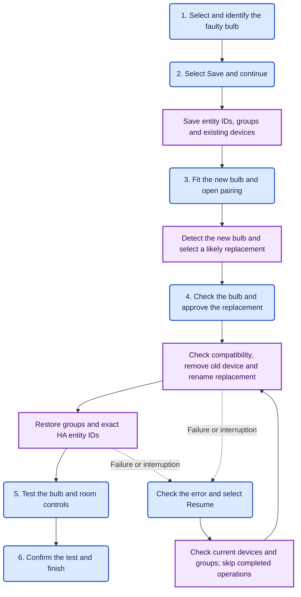
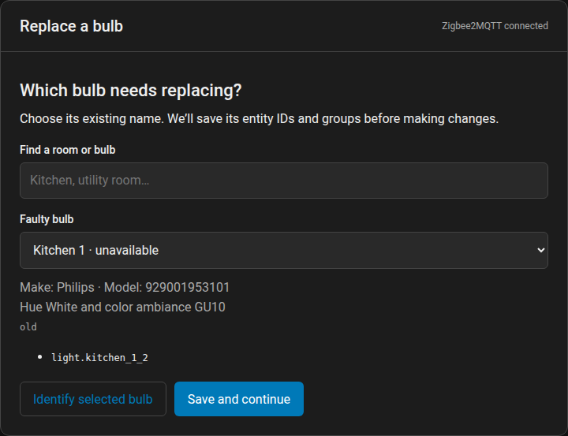
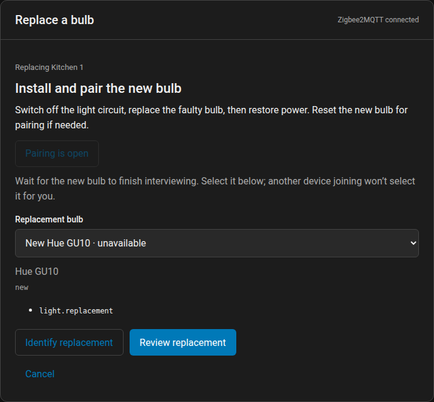
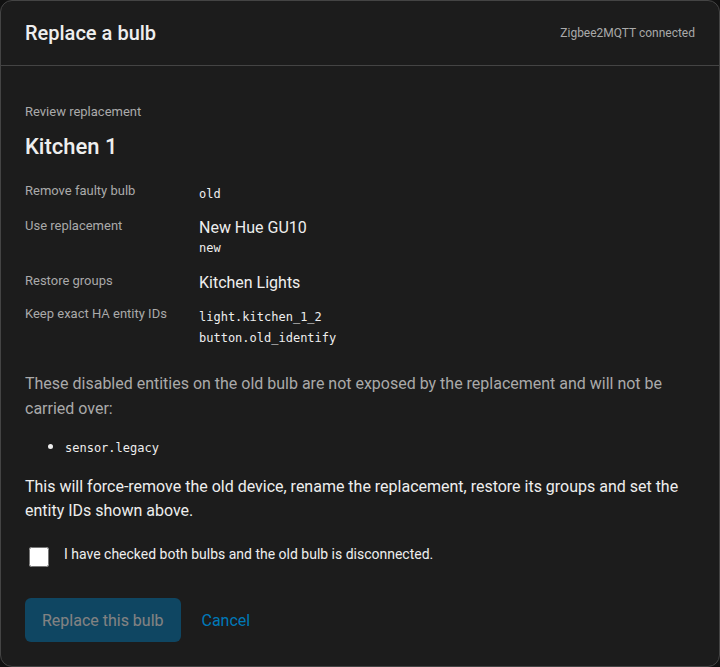
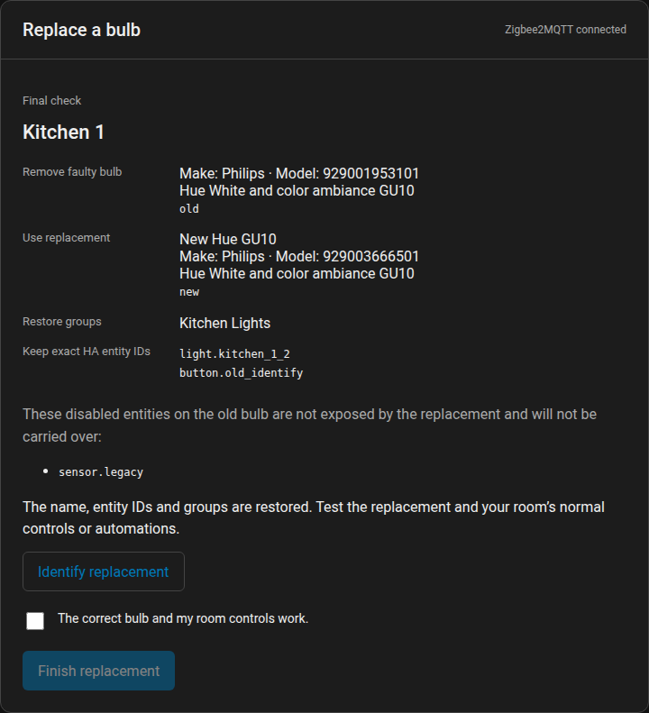
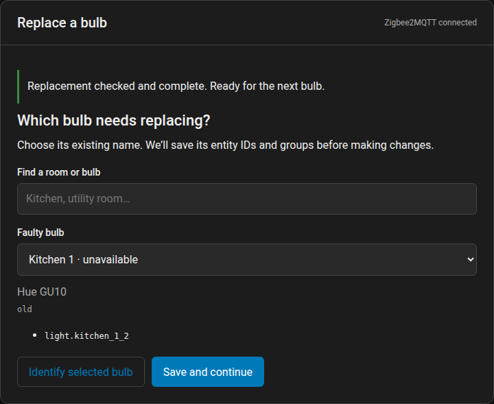

# Zigbee2MQTT Device Swap

Replace a failed Zigbee bulb from Home Assistant. Keep its exact Home Assistant entity IDs and Zigbee2MQTT groups.

Select the old bulb. Fit and pair its replacement. Check the details, then approve the change. The integration handles device removal, renaming, group membership and entity IDs.

**Status: early development, tested with physical Philips Hue GU10 replacements.** Testing used Home Assistant 2026.10.4 and Zigbee2MQTT 2.14.2. Individual bulb controls and group controls work. Other devices and versions still need testing.

## Requirements

- Home Assistant 2026.10 or later.
- Zigbee2MQTT 2.x with Home Assistant discovery enabled.
- The Home Assistant MQTT integration connected to the same broker.
- A Home Assistant administrator account.
- Single-channel light bulbs with compatible features and group endpoints.

Philips Hue bulbs with light endpoint 11 and Green Power endpoint 242 are supported.

The integration uses your existing MQTT connection. The card uses your Home Assistant session. You do not need a cloud service or another API key. Only the optional installation scripts need a token.

## Install

### Install through HACS

[HACS](https://www.hacs.xyz/docs/use/) must already be installed. Add this integration as a **custom repository**.

1. Open **HACS**. Open the three-dot menu. Select **Custom repositories**.
2. Enter `https://github.com/simonjgreen/z2m-device-swap`. Select **Integration** as the repository type. Select **Add**.
3. Find **Zigbee2MQTT Device Swap**. Open its page. Select **Download**. Select the latest release.
4. Restart Home Assistant.
5. Open **Settings → Devices & services → Add integration**. Search for **Zigbee2MQTT Device Swap**. Select the integration.
6. Enter your Zigbee2MQTT MQTT base topic. The default is `zigbee2mqtt`.
7. Add the card to a dashboard. Use the configuration below.

If the integration does not appear after the restart, reload the browser page with **Ctrl+Shift+R**.

For updates, download the update through HACS. Restart Home Assistant. Reload the dashboard page.

### Manual installation

Copy `custom_components/z2m_device_swap` into the `custom_components/` folder in your Home Assistant configuration directory. Restart Home Assistant.

Open **Settings → Devices & services → Add integration**. Add **Zigbee2MQTT Device Swap**. Enter the MQTT base topic.

### Add the dashboard card

The integration loads the card JavaScript automatically. A normal Home Assistant dashboard provides the navigation, layout and edit controls.

Open a dashboard. Select **Edit → Add card**. Search for **Zigbee2MQTT Device Swap**. Add the card.

If you have one Device Swap integration, the card connects automatically. You do not need its entry ID.

If you have several Device Swap integrations, select one by name in the card editor.

For manual YAML configuration, use:

```yaml
type: custom:z2m-device-swap-card
```

Existing configurations with an explicit `entry_id` still work. The visual editor can change that selection.

If you manage dashboard resources manually, add `/z2m_device_swap/z2m-device-swap-card.js?v=0.1.6` as a JavaScript module.

The optional setup script can create a separate dashboard:

```sh
python3 scripts/setup_ha.py --ha-url http://YOUR_HA:8123 --dashboard
```

The script uses supported Home Assistant APIs. It keeps existing dashboards and their edits.

## Replacement flow

**Six human stages. One dashboard card.** Select the bulb, save its details, fit and pair the replacement, approve the change, test it, then finish.

The card keeps the admin work short. It selects a likely replacement and shows its make, model, entity IDs and groups. You check the bulb and approve the change. The integration handles the rest.

The manual procedure means removing the old device, renaming its replacement and restoring group membership in Zigbee2MQTT. You then check and correct the entity IDs in Home Assistant. This card handles those changes in one flow. You still fit the bulb, wait for pairing and test the controls.

**Diagram key:** rounded blue boxes show your actions. Square purple boxes show automatic actions. The six numbered stages show the normal flow. An interrupted replacement adds a recovery step.



The integration checks required entities and group endpoints before removal. The saved snapshot supports recovery after an interruption. If several new bulbs arrive together, you select the replacement yourself.

## Replace one bulb

1. **Select the faulty bulb.** Check its make, model and description below the selector. Use **Identify selected bulb** to flash it. A dead or unpowered bulb cannot flash. Identify the working bulbs nearby to locate the faulty one. Home Assistant can show an old on/off state for an unavailable bulb.
2. **Select Save and continue.** The integration saves the exact entity IDs, group memberships and list of existing devices. It does not change the devices at this stage.
3. **Fit and pair the new bulb.** Switch off the light circuit. Replace the faulty bulb. Restore power. Open the two-minute pairing window. If necessary, reset the new bulb for pairing. Wait for the device interview and Home Assistant discovery to finish.
4. **Check and approve the replacement.** The card selects a single newly detected bulb as the likely replacement. Check its make and model. Use **Identify replacement** to flash it. If the selection is wrong, select the correct bulb. Later arrivals do not change your manual selection.

   Select **Review replacement**. Check both device addresses. Check the entity IDs and groups. Confirm that the old bulb is disconnected. Select **Replace this bulb**. The integration removes the old device, renames the replacement and restores its groups and exact entity IDs. Removal also works when the old bulb is offline.
5. **Test your controls.** Test the new bulb individually. Test the normal room controls and automations.
6. **Confirm and finish.** Select the checkbox to confirm that the controls work. Select **Finish replacement**. You can then start the next bulb.

## Screenshots

These screenshots show the actual card with sample devices. Your Home Assistant theme and dashboard control its appearance.

| 1. Select the faulty bulb | 2. Pair its replacement |
| --- | --- |
|  |  |

| 3. Review the replacement | 4. Test the controls |
| --- | --- |
|  |  |

5. Replacement complete. Ready for the next bulb.



## Scope and recovery

The integration preserves entity IDs and group membership. It does not transfer internal Home Assistant device IDs or device-based automation references. It does not transfer direct Zigbee bindings, device settings or Zigbee scenes.

A missing enabled entity or main light entity stops the replacement before removal. A different group endpoint also stops it. Disabled entities missing from the replacement appear separately during review. The integration does not transfer them. Matching disabled entities keep their IDs and settings. An entity ID conflict stops the flow. The integration does not delete unrelated entries.

The integration saves the snapshot and pending operation before each change. Home Assistant stores this record under `z2m_device_swap.<entry_id>`. It keeps the previous 20 completed or cancelled snapshots when you start another replacement. The snapshot records the original setup. It cannot restore a physically dead bulb.

Take your normal Home Assistant and Zigbee2MQTT backups before the first replacement.

If a request times out or Home Assistant restarts, the card shows **Needs attention**. Keep the replacement powered. After a timeout, wait at least 35 seconds. Check the device and its groups. Select **Review state and resume**.

Recovery checks the current devices and groups. It skips completed operations. After removal starts, you must recover the saved replacement. You cannot cancel it. Entity restoration can take up to 30 seconds while Home Assistant processes discovery changes.

Pairing windows opened from this card expire after two minutes. The integration does not close a window opened by another tool.

## Development

```sh
python3 -m unittest discover -s tests -v
python3 -m compileall -q custom_components
node --check custom_components/z2m_device_swap/frontend/z2m-device-swap-card.js
```

The Python tests cover the workflow, compatibility checks, lost responses, recovery and exact entity matching. They do not run Home Assistant.

For browser checks, serve the project locally on port 8765. Start Chromium with a temporary profile and debugging port 9223. Run `scripts/check_card.py`. It uses `tests/card-preview.html`. It does not connect to Home Assistant. The helper scripts need the Python `websockets` package.

The installation script uses the File editor add-on. It checks the installed files:

```sh
python3 scripts/install_ha.py --ha-url http://YOUR_HA:8123
```

Add `--install` to install the integration. The script checks each uploaded file. It refuses to replace an existing installation. It does not restart Home Assistant.

For an update, use `--update-from COMMIT --install`. The script first checks that every installed file matches that commit. It backs up each changed file before replacement. It then checks the uploaded files.

The scripts request tokens without displaying them. Tokens stay in memory.

### Releases

HACS installs the `z2m_device_swap.zip` asset from a published GitHub release. GitHub records the download count for that asset.

A manifest version change on `main` creates a draft release and builds its ZIP. The archive contains the integration files directly. Publish the draft after the tests and validation pass. Published archives stay unchanged. A correction needs a new version and release.

The [releases page](https://github.com/simonjgreen/z2m-device-swap/releases) lists the available versions. Asset download counts measure downloads, not unique users or active installations.


See [the research notes](docs/research.md) for sources and scope.
